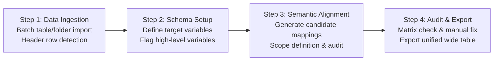

# 异构归一 (Semantic-Table-Harmonizer)

**面向实证研究的多源异构调查数据语义对齐与多层级整合工具**

<strong>纯前端本地解析 · 多层级变量元数据提取 · 语境消歧 · 本地规则与大语言模型协同</strong>

<a href="#english-version">English Version</a> | <a href="#-一项目背景与核心功能">中文文档</a>

---

**获取方式：①请在页面右侧的Release区域下载工具压缩包，解压即用（把东西都放在一个文件夹！）！②选择exe可执行文件独立窗口使用，也可以使用html网页端直接使用**

## 📖 一、项目背景与核心功能

在社会学、经济学、人口学、公共管理及流行病学等领域的定量实证研究中，研究者常需整合多来源（如多区域抽样调查）或多时序波次（如长期追踪面板）的 Excel/CSV 调查表格，构建统一标准宽表。多源数据在表头命名、结构组织和测量口径上普遍存在异构性，给数据清洗与标准化带来诸多挑战：

| 常见挑战 | 具体表现与实证分析影响 | 工具处理策略 |
| :--- | :--- | :--- |
| **同义异构表头** | 相同指标在不同期数或子样本中命名存在差异（例如 `家庭年收入`、`户年均总收入`、`可支配年收入`），手动检索耗时且易遗漏。 | **分级语义拓展机制**：结合社科常用词表与大模型推理，生成不同置信梯度的候选表头。 |
| **高层级变量缺列** | 针对面板数据或分层抽样数据，原始数据常以“一省一表”或“一年一表”存储，表内未单设 `省份` 或 `波次` 列，分组变量隐含于文件名中。 | **高层级变量元数据解析**：支持将分组标识（如地区、年份、期数）标记为高层级变量，在表内缺列时自动从文件名中解析并填充。 |
| **层级嵌套与概念重叠** | 同时提取宽泛范畴（如 `所属单位`）与细分指标（如 `省份`），或总体指标与分项指标时，宽泛变量的候选词容易误占细分指标列。 | **语义层级与范围约束**：引入语义边界控制，优先保障细分指标的对齐，并支持交互式设定释义范围以收窄统计口径。 |
| **维度漂移与量纲差异** | 易将相近构念混淆（如学历程度与受教育年限，或行政区划与城乡属性），或混入不同数量级单位（如 `万元` 与 `元`）。 | **构念一致性与单位校验**：在候选生成与终检阶段辅助排查测量构念与计量单位，降低跨维度混淆风险。 |
| **共有修饰词导致的误报** | 传统文本匹配机制容易因定语修饰词重合（如 `家庭年收入` 与 `调查年份` 均含时间修饰）而误判为语义冲突。 | **核心构念与修饰成分辨析**：区分测量中心词与辅助修饰成分，避免因共有修饰词产生虚假冲突提示。 |

---

## ✨ 二、系统特性

* **轻量化单文件架构与本地数据处理**：纯前端静态架构，可通过主流现代浏览器（Chrome、Edge、Firefox、Safari）直接运行。数据解析与宽表合并均在本地浏览器内存中完成，不向外部服务器传输微观调查数据。
* **面向多水平模型（Multilevel Models）的高层级元数据提取**：支持将行政区划、调查波次等关键聚类变量设为高层级变量。在源数据表缺列时，自动从规范的文件命名中提取对应属性补齐，适配面板分析与混合效应模型。
* **分级语义标签体系**：区分基础词表映射、狭义精确对齐与广义概念拓展，提供透明、可追溯的候选推荐。
* **透明可定制的多学科内置词典**：系统内置了大量跨学科（社会学、经济学、人口学、公共卫生等）常用的标准变量信息与同义词规则；所有明文指定的词典内容均可通过 `Semantic_Table_Harmonizer_dictionary` 词典文件直接查看、编辑与扩充定制。
* **离线规则与大模型协同**：无需配置 API 即可离线完成常规表头泛化与校验；亦可接入兼容 OpenAI 格式的大语言模型，辅助复杂语境下的语义消歧与未匹配诊断。
* **规则方案本地持久化**：支持将目标模式、字段释义及自定义提示词保存在本地存储（`localStorage`），支持配置方案的导入、导出与合并。

---

## 🛠️ 三、标准化工作流

1. **数据导入（Data Ingestion）**：批量导入多份 `.xlsx`、`.xls`、`.csv` 或 `.ods` 表格，支持文件夹拖入解析与表头所在行自适应调整。
2. **模式配置（Schema Configuration）**：定义目标宽表的标准变量集合与列排列顺序；针对面板或分层抽样数据，可指定需从文件名元数据中解析的高层级分组变量。
3. **语义对齐（Semantic Alignment）**：结合领域词表与模型推理生成候选表头映射，支持为特定字段设定统一口径，并提供表头歧义与一致性校验。
4. **核验与导出（Verification & Export）**：通过映射矩阵直观复核每份表格的对齐状态，支持交互微调未匹配列，确认无误后流式导出合并宽表。

---

## 🧠 四、系统处理机制简述

* **层次化语义边界控制**：在处理存在上下位关联或口径交叉的指标时，建立语义范围约束，防止上位宽泛概念与下位细分指标发生表头冲突。
* **语境感知的构念辨析**：结合指标的核心测量构念与修饰成分进行上下文识别，减少因局部共有字词引发的误判。
* **有序列映射与回退策略**：遵循确定性优先原则执行字段分配，避免列争用；对数据表内缺失的高层级变量，自动调用文件名元数据进行回退补全。

---

## ⚠️ 五、数据安全与使用建议

1. **本地环境与数据隐私**：
   * 文件的读取、计算及导出均在本地浏览器环境中执行，原始调查样本数据不会上传至第三方服务器。
   * 若启用大模型辅助功能，仅会向用户指定的接口发送变量名、说明及表头文本。如表头含涉密或敏感信息，建议使用离线模式或预先脱敏。
2. **文件名命名规范**：
   * 若依赖文件名提取高层级变量（如省份、年份），建议源文件命名保持规范统一（如包含标准年份或规范行政区划名称）。
3. **人工复核原则**：
   * 工具旨在提高异构表头对齐效率，最终导出前建议结合映射矩阵与研究设计的统计口径要求进行抽样复核。
4. **大语言模型调用开销与选型参考**：
   * 在一个包含 2 次 AI 泛化与 4 次 AI 检查的标准完整工作流中，系统累计约调用 9 次 LLM 接口。
   * 以轻量级模型（如 `DeepSeek-4.1-Flash` 等 Flash 级别模型）为例，单次完整流程的总体 Token 消耗量通常在 100k 以内，总调用费用约在人民币 0.4～0.6 元。
   * 实测表明，Flash 级别模型在具备低成本与高响应速度优势的同时，完全足以稳定胜任表头消歧与一致性校验任务。

---

# Semantic-Table-Harmonizer

**A Client-Side Semantic Schema Harmonization and Multilevel Data Aggregation Tool for Empirical Research**

<strong>Pure Client-Side Processing · Multilevel Variable Metadata Extraction · Contextual Disambiguation · Hybrid Local Rule & LLM Alignment</strong>

<a href="#异构归一-semantic-table-harmonizer">Back to Chinese Version</a>

---

## 📖 1. Motivation and Problem Formulation

In empirical quantitative research across sociology, economics, demography, public administration, and epidemiology, researchers routinely integrate multiple raw Excel/CSV survey tables from diverse sampling units or repeated longitudinal panels into a unified analysis-ready wide format. Raw survey tables from disparate sources exhibit substantial schema heterogeneity, posing recurring challenges during data cleaning and standardization:

| Common Challenges | Manifestation & Empirical Risks | System Approach |
| :--- | :--- | :--- |
| **Synonymous Schema Heterogeneity** | The same empirical construct is named inconsistently across waves or sub-samples (e.g., `Annual Household Income`, `Gross Family Income`), making manual searching time-consuming and error-prone. | **Tiered Semantic Expansion**: Combines curated domain lexicons with model-assisted inference to generate candidate headers across confidence tiers. |
| **Missing High-Level Cluster Variables** | In panel data or multilevel modeling, datasets are often partitioned across files (e.g., one sheet per province or year) without internal columns for `Province` or `Wave`. Grouping identifiers exist only in filenames. | **Hierarchical Metadata Extraction**: Flags grouping identifiers as higher-level variables, automatically extracting missing cluster attributes from filenames during consolidation. |
| **Hierarchical Subsumption & Overlap** | When extracting both broad categories (e.g., `Administrative Unit`) and granular indicators (e.g., `Province`), broad candidate terms frequently misclaim specific column headers. | **Semantic Hierarchy & Scope Boundaries**: Enforces boundary constraints to protect specific indicators and allows interactive scope definitions to narrow operational definitions. |
| **Construct Drift & Dimensional Discrepancies** | Collinear constructs risk being conflated (e.g., educational attainment vs. schooling years), as well as scale discrepancies (e.g., units in tens of thousands vs. single units). | **Construct Consistency & Unit Verification**: Validates measurement constructs and metric units during candidate generation and final auditing to reduce cross-dimensional confusion. |
| **False Collisions from Shared Modifiers** | Lexical matching frequently triggers false alerts when peripheral modifiers overlap (e.g., shared temporal tokens between `Annual Household Income` and `Survey Year`). | **Construct Core vs. Modifier Disambiguation**: Differentiates core measurement constructs from peripheral modifiers, preventing spurious collision alerts. |

---

## ✨ 2. Key Features

* **Lightweight Single-File Client-Side Architecture**: Standalone single-file HTML application executable in modern web browsers (Chrome, Edge, Firefox, Safari) without server deployment. Table parsing and consolidation run entirely within local browser memory, keeping microdata private.
* **Hierarchical Metadata Parsing for Multilevel Models**: Supports designating geographic divisions or temporal waves as higher-level variables. When tables omit these columns, the system parses values from standardized filenames to support panel and mixed-effects analysis.
* **Tiered Semantic Traceability**: Clearly categorizes matches into base lexical mappings, strict semantic alignments, and broad conceptual extensions for transparent recommendations.
* **Customizable Multidisciplinary Pre-built Dictionaries**: Pre-configured with extensive variable taxonomies covering diverse disciplines (sociology, economics, demography, public health, etc.). All explicitly specified dictionaries can be modified and extended directly via the `Semantic_Table_Harmonizer_dictionary` dictionary file to suit domain-specific requirements.
* **Offline Rules and LLM Collaboration**: Operates offline using built-in domain dictionaries and verification rules; also connects with OpenAI-compatible LLM endpoints for contextual disambiguation and unmapped column diagnostics.
* **Local Schema & Rule Persistence**: Stores target schemas, operational definitions, and custom prompts in local browser storage (`localStorage`), complete with import/export capabilities.

---

## 🛠️ 3. Operational Workflow

1. **Data Ingestion**: Batch import `.xlsx`, `.xls`, `.csv`, or `.ods` files or folders, with adaptive header row detection.
2. **Schema Setup**: Specify standardized target column names and ordering; flag grouping variables to be automatically extracted from filename metadata when missing in source tables.
3. **Semantic Alignment**: Generate candidate mappings using domain lexicons and model inference, define custom operational scopes, and run consistency audits.
4. **Audit and Export**: Review alignment statuses across all tables via a visual mapping matrix, interactively adjust unmapped columns, and stream-export the consolidated wide table.

---

## 🧠 4. Core Processing Principles

* **Hierarchical Semantic Boundary Control**: Applies scope boundaries across related or overlapping indicators, preventing broad categories from misallocating columns belonging to specific sub-indicators.
* **Context-Aware Construct Disambiguation**: Evaluates core measurement constructs alongside modifying components in context, mitigating false-positive alerts caused by superficial lexical overlap.
* **Ordered Column Allocation & Fallback**: Follows a priority-driven allocation strategy to avoid column contention, utilizing filename metadata as a reliable fallback for omitted higher-level variables.

---

## ⚠️ 5. Data Privacy and Usage Recommendations

1. **Client-Side Privacy Boundaries**:
   * File parsing, matching computation, and data consolidation run entirely within the local browser runtime. Microdata survey observations are never transmitted to external servers.
   * When LLM-assisted features are enabled, only variable names, descriptions, and header labels are sent to the configured endpoint. If headers contain sensitive project metadata, use offline mode or sanitize labels beforehand.
2. **Filename Consistency**:
   * When relying on metadata extraction for missing cluster variables, ensure filenames adhere to systematic conventions (e.g., standard four-digit years or official administrative division names).
3. **Human-in-the-Loop Verification**:
   * While automated alignment substantially improves data harmonization efficiency, researchers should review the mapping matrix against empirical measurement definitions prior to running econometric or statistical analyses.
4. **LLM Invocation Overhead & Model Recommendation**:
   * Across a standard complete workflow (comprising 2 AI generalizations and 4 AI consistency audits), approximately 9 LLM API calls are executed.
   * Benchmarked with lightweight models such as `DeepSeek-4.1-Flash` (or comparable Flash-tier models), total token consumption typically remains within 100k tokens, incurring an estimated cost of 0.4–0.6 RMB (¥0.4–¥0.6).
   * Empirical evaluation demonstrates that Flash-tier models provide both high execution speed and cost efficiency, proving fully sufficient for handling column disambiguation and consistency checking tasks reliably.
